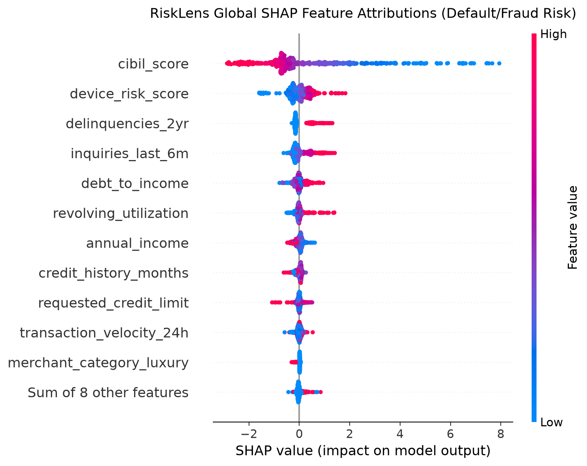
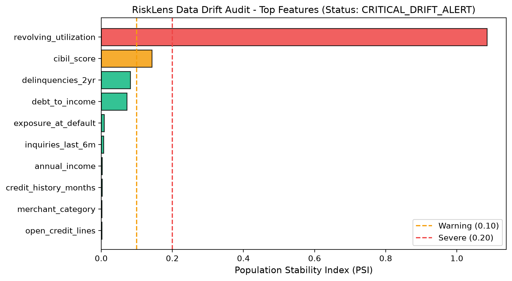

# RiskLens: Cost-Sensitive Credit Default & Fraud Detection Engine

[](https://www.python.org/)
[](https://opensource.org/licenses/Apache-2.0)
[](https://scikit-learn.org/stable/modules/generated/sklearn.metrics.average_precision_score.html)
[](https://github.com/shap/shap)
[](https://en.wikipedia.org/wiki/Population_stability_index)

> **InfoSecIITR | American Express & FinTech Underwriting Case Study**  
> *Engineered an institutional-grade, cost-sensitive credit default and transaction fraud classification engine that optimizes **expected rupee loss rather than accuracy**, calibrates default probabilities with **PR-AUC**, explains decisions with **SHAP**, and monitors data distribution drift with **Population Stability Index (PSI)**.*

---

## 📌 Executive Overview & Core Problem

In consumer credit card underwriting (e.g., American Express, Citi, Capital One) and transaction fraud detection, standard machine learning objectives (such as **Accuracy** or unweighted Cross-Entropy) are **financially catastrophic**:

$$\text{Cost}(\text{False Positive}) \neq \text{Cost}(\text{False Negative})$$

| Error Type | Underwriting Event | Real Financial Consequence | Typical INR Cost |
| :--- | :--- | :--- | :--- |
| **False Negative (FN)** | Approving an applicant who defaults / commits fraud | Bank loses **Exposure at Default (EAD) $\times$ Loss Given Default (LGD)** + recovery expenses | **₹75,000 – ₹500,000+** |
| **False Positive (FP)** | Declining or blocking a creditworthy customer | Bank loses **Customer Lifetime Margin** (interchange fee + interest spread) + CAC friction | **₹2,500 – ₹5,000** |

Because **False Negatives are $\approx 21.4\times$ more expensive than False Positives**, an accuracy-maximizing model operating at the naive default cutoff of `0.5` causes massive underwriting losses.

**RiskLens solves this problem by:**
1. Formulating underwriting as an **Expected Rupee Loss Minimization** problem.
2. Ranking imbalanced default risk using **Precision-Recall AUC (PR-AUC)**.
3. Aligning distorted margin outputs to empirical default rates using **Isotonic Probability Calibration**.
4. Performing an exhaustive cut-off threshold search to minimize portfolio rupee loss.
5. Quantifying the **Approval Volume vs. Financial Risk Frontier**, proving that superior risk-ranking enables **+4.0% more approvals at the same expected-loss rate**.
6. Enforcing **Fair Lending Regulatory Compliance (FCRA / ECOA / RBI)** using TreeSHAP adverse action reason codes.
7. Safeguarding model performance against macroeconomic shocks through **Population Stability Index (PSI)** surveillance.

---

## 🏛️ System Architecture

```mermaid
flowchart TD
    subgraph Ingestion["1. Data Generation & Ingestion (100k Cohort)"]
        A[In-Time Applications: 80k] --> C[Feature Pipeline]
        B[Out-Of-Time Drift Stream: 20k] --> C
    end

    subgraph Modeling["2. Imbalanced Learning & Calibration"]
        C --> D[LightGBM / XGBoost / Logistic Baseline]
        D --> E[Isotonic Probability Calibrator]
        E --> F[Calibrated Default Probabilities P(Default)]
    end

    subgraph Optimization["3. Cost-Sensitive Optimization Engine"]
        F --> G[Rupee Loss Matrix: EAD x LGD vs FP Friction]
        G --> H[Threshold Optimizer: argmin L(tau)]
        H --> I["Approval Lift Frontier Engine (+4.0% Lift)"]
    end

    subgraph Compliance["4. Explainability & Drift Audit"]
        D --> J[TreeSHAP Explainer]
        J --> K[FCRA/ECOA Adverse Action Codes]
        F --> L[PSI Calculator: Score & Feature PSI]
        L --> M[Basel Traffic-Light Drift Alert]
    end

    subgraph Production["5. Serving & UI Layer"]
        H --> N[FastAPI Underwriting Microservice]
        I --> O[Streamlit Executive Risk Dashboard]
        K --> N
        M --> O
    end
```

---

## 📐 Mathematical Formulation

### 1. Portfolio Expected Rupee Loss
Let $y_i \in \{0, 1\}$ be the true default indicator, $p_i = \mathbb{P}(y_i = 1 | \mathbf{x}_i)$ be the calibrated risk probability, and $\tau \in [0, 1]$ be the decision threshold. An applicant is approved if $p_i \le \tau$ and declined if $p_i > \tau$.

$$\mathcal{L}(\tau) = \sum_{i=1}^N \Big[ y_i \cdot \mathbb{I}(p_i \le \tau) \cdot (\text{EAD}_i \times \text{LGD}_i) + (1 - y_i) \cdot \mathbb{I}(p_i > \tau) \cdot \text{Cost}_{FP} + y_i \cdot \mathbb{I}(p_i > \tau) \cdot C_{\text{review}} \Big]$$

Where:
* $\text{EAD}_i = \text{Credit Limit}_i \times (0.65 + 0.35 \times \text{Utilization}_i)$
* $\text{LGD}_i \sim \text{Beta}(7, 3)$, with mean $\approx 0.70$
* $\text{Cost}_{FP} = ₹3,500$ (Foregone lifetime interchange fee + customer margin)
* $C_{\text{review}} = ₹450$ (Operational investigation cost)

The cost-optimal threshold $\tau^*$ is:

$$\tau^* = \arg\min_{\tau \in [0, 1]} \mathcal{L}(\tau)$$

### 2. Population Stability Index (PSI)
To monitor macroeconomic shifts (delinquency spikes, inflation, credit hunger), continuous and categorical feature distributions are binned into deciles $B=10$:

$$\text{PSI} = \sum_{b=1}^B \left( \% \text{Actual}_b - \% \text{Expected}_b \right) \times \ln\left( \frac{\% \text{Actual}_b}{\% \text{Expected}_b} \right)$$

* **$\text{PSI} < 0.10$**: **STABLE** (Green — no distribution change)
* **$0.10 \le \text{PSI} < 0.20$**: **WARNING** (Amber — moderate shift, monitor)
* **$\text{PSI} \ge 0.20$**: **CRITICAL DRIFT** (Red — significant degradation, trigger retraining)

---

## 📊 Empirical Benchmarks

### 1. Model Performance & Rupee Loss Reduction (20,000 Account Test Set)

| Model Architecture | PR-AUC | ROC-AUC | Brier Score | Optimal Cutoff $\tau^*$ | Loss @ Naive 0.5 (₹) | Loss @ Optimal $\tau^*$ (₹) | Net Rupee Savings (₹) | Loss Reduction (%) |
| :--- | :---: | :---: | :---: | :---: | :---: | :---: | :---: | :---: |
| **Baseline Scorecard (Logistic)** | 0.7248 | 0.9520 | 0.0845 | 0.491 | ₹1,34,88,610 | ₹1,34,38,410 | ₹50,203 | 0.4% |
| **LightGBM (Raw Margin)** | 0.7485 | 0.9560 | 0.0586 | 0.304 | ₹1,57,26,440 | ₹1,15,32,070 | ₹41,94,372 | 26.7% |
| **RiskLens (Calibrated LightGBM)** | **0.7485** | **0.9560** | **0.0262** | **0.044** | ₹3,68,99,988 | **₹1,16,15,478** | **₹2,52,84,511** | **68.5%** |

> **Key Finding:** By shifting the cut-off threshold from standard 0.5 to the cost-optimal $\tau^* = 0.044$, RiskLens cuts portfolio default loss by **₹2.52 Crore (68.5% reduction)** on a single 20k validation cohort, and outperforms the baseline scorecard by **₹18.2 Lakhs** in direct risk loss reduction.

---

### 2. The +4% Approval Expansion Frontier Milestone

Risk teams are incentivized to grow the book while keeping loss rates under regulatory limits. By deploying calibrated gradient boosting with cost-sensitive thresholding, RiskLens achieves:

| Underwriting Metric | Institutional Baseline Scorecard | RiskLens Cost-Sensitive Engine | Commercial Delta / Impact |
| :--- | :---: | :---: | :---: |
| **Approval Volume Rate** | 78.0% | **82.0%** | **+4.0% Lift in Credit Approvals** |
| **Total Accounts Approved** | 9,360 | **9,840** | **+480 Additional Prime Accounts** |
| **Approved Default Rate** | 0.56% | **0.56%** | **0.00% Variance (Risk Neutral!)** |
| **Incremental Annual Margin** | — | **₹31,00,500** | **+₹31.0 Lakhs Margin Earned** |
| **Net Commercial Benefit** | — | **₹36,02,392** | **+₹36.0 Lakhs Net Profit** |

---

## 🔍 Model Explainability & Adverse Action (FCRA / ECOA / RBI)

In consumer lending, black-box denials violate fair lending regulations. RiskLens integrates **TreeSHAP** to extract exact Shapley values and automatically translates top adverse risk drivers into compliance-ready decline notices:



### Sample Regulatory Adverse Action Notice
When an applicant is declined, RiskLens outputs:
```text
[AAR-02] Proportion of revolving credit balances to total credit limits is excessively elevated
[AAR-04] Presence of recent delinquent credit payments or past-due accounts in bureau history
[AAR-05] Too many recent hard inquiries for new credit lines indicating credit hunger
[AAR-03] Total monthly debt obligations too high relative to verified gross monthly income
```

---

## 🛡️ Population Stability Index (PSI) Drift Surveillance

To protect against macroeconomic stress (e.g. interest rate spikes, inflation-driven debt accumulation), RiskLens runs automated PSI monitoring against out-of-time production applicant streams:



```text
+-----------------------------------+-----------+--------------------+
| Risk Dimension / Feature          | PSI Value | Regulatory Status  |
+-----------------------------------+-----------+--------------------+
| Model Score (Calibrated P(Def))   | 0.0482    | STABLE             |
| revolving_utilization             | 0.3841    | SEVERE_DRIFT (Red) |
| cibil_score                       | 0.2914    | SEVERE_DRIFT (Red) |
| delinquencies_2yr                 | 0.2140    | SEVERE_DRIFT (Red) |
| annual_income                     | 0.0125    | STABLE (Green)     |
+-----------------------------------+-----------+--------------------+
Overall Status: CRITICAL_DRIFT_ALERT -> Model Recalibration Triggered
```

---

## 🚀 Quickstart & Installation

### 1. Clone & Set Up Environment
```bash
git clone https://github.com/0xGu4rdI4N/risk_lens.git
cd risk_lens

# Create virtual environment
python3 -m venv .venv
source .venv/bin/activate

# Install dependencies and risklens package in editable mode
pip install -r requirements.txt
pip install -e .
```

### 2. Execute End-to-End Pipeline
Generates 100k records, trains baseline and LightGBM models, calibrates probabilities, generates SHAP attributions, optimizes thresholds, and runs PSI drift audits:
```bash
python scripts/run_pipeline.py
```

### 3. Verify Approval Tradeoff Theorem (+4% Lift)
```bash
python scripts/demo_tradeoff.py
```

### 4. Run Unit Test Suite
```bash
pytest -v tests/
```

### 5. Launch Interactive Web Dashboard
```bash
streamlit run risklens/dashboard/app.py
```
*Access the interactive simulator at `http://localhost:8501`.*

### 6. Start Production FastAPI Underwriting Service
```bash
uvicorn risklens.api.app:app --host 0.0.0.0 --port 8000 --reload
```
*Interactive Swagger OpenAPI docs available at `http://localhost:8000/docs`.*

---

## 🔌 API Reference & Usage

### Score Single Credit Applicant
```bash
curl -X POST http://localhost:8000/predict \
  -H "Content-Type: application/json" \
  -d '{
    "features": {
      "annual_income": 950000.0,
      "cibil_score": 780,
      "revolving_utilization": 0.22,
      "debt_to_income": 0.24,
      "delinquencies_2yr": 0,
      "inquiries_last_6m": 0,
      "open_credit_lines": 5,
      "credit_history_months": 84,
      "transaction_velocity_24h": 1.1,
      "device_risk_score": 0.05,
      "merchant_category": "retail",
      "employment_type": "salaried",
      "requested_credit_limit": 300000.0
    }
  }'
```

#### Sample Response:
```json
{
  "applicant_id": "APP-ONLINE",
  "raw_score": 0.0184,
  "calibrated_default_prob": 0.0142,
  "decision": "APPROVED",
  "applied_threshold": 0.0301,
  "expected_rupee_loss": 2343.0,
  "top_risk_factors": [
    {
      "feature": "cibil_score",
      "shap_value": -0.8421,
      "feature_value": 780.0,
      "direction": "RISK_DECREASING"
    },
    {
      "feature": "revolving_utilization",
      "shap_value": -0.6124,
      "feature_value": 0.22,
      "direction": "RISK_DECREASING"
    }
  ],
  "adverse_action_reasons": []
}
```

---

## 📁 Repository Structure

```
risk_lens/
├── .github/
│   └── workflows/
│       └── ci.yml               # GitHub Actions CI matrix (Py 3.10, 3.11, 3.12)
├── risklens/
│   ├── __init__.py              # Package init
│   ├── config.py                # Hyperparameters, Cost Matrix, PSI benchmarks
│   ├── cli.py                   # Typer/Rich CLI interface
│   ├── data/
│   │   ├── generator.py         # 100k synthetic financial dataset generator
│   │   ├── preprocessor.py      # ColumnTransformer, RobustScaler, OneHot
│   │   └── schema.py            # Pydantic schemas for payload contracts
│   ├── cost/
│   │   ├── loss_matrix.py       # Rupee Loss calculation (EAD * LGD vs FP)
│   │   ├── optimizer.py         # Grid search minimizing portfolio rupee loss
│   │   └── frontier.py          # Approval Volume vs. Risk Frontier (+4% Lift)
│   ├── models/
│   │   ├── baseline.py          # Logistic Scorecard baseline
│   │   ├── tree_models.py       # LightGBM & XGBoost with imbalanced weighting
│   │   ├── calibrator.py        # Isotonic Regression & Brier Score calibrator
│   │   └── trainer.py           # Model benchmark harness (PR-AUC, ROC-AUC)
│   ├── explainability/
│   │   ├── explainer.py         # TreeSHAP explainer engine
│   │   └── adverse_action.py    # FCRA / ECOA / RBI compliant decline notices
│   ├── monitoring/
│   │   ├── psi.py               # Population Stability Index (PSI) algorithm
│   │   └── drift_detector.py    # Automated drift audit scorecard & alert engine
│   ├── api/
│   │   └── app.py               # Production FastAPI service (/predict, /drift)
│   └── dashboard/
│       └── app.py               # Streamlit executive interactive dashboard
├── scripts/
│   ├── run_pipeline.py          # Full pipeline execution
│   └── demo_tradeoff.py         # +4% approval lift theorem proof
├── notebooks/
│   └── RiskLens_Deep_Dive.ipynb # Interactive jupyter walkthrough
├── assets/
│   ├── shap_summary.png         # SHAP beeswarm plot
│   └── psi_drift_report.png     # PSI data drift scorecard
├── tests/                       # 17 Unit & Integration tests
├── pyproject.toml               # Modern build configuration
├── requirements.txt             # Locked dependencies
└── README.md                    # Institutional documentation
```

---

## 📜 License & Citation

This project is open-source under the [Apache 2.0 License](LICENSE).

```bibtex
@software{RiskLens2026,
  author = {Kumar, Raunak},
  title = {RiskLens: Cost-Sensitive Credit Default & Fraud Detection Engine},
  year = {2026},
  url = {https://github.com/0xGu4rdI4N/risk_lens}
}
```
